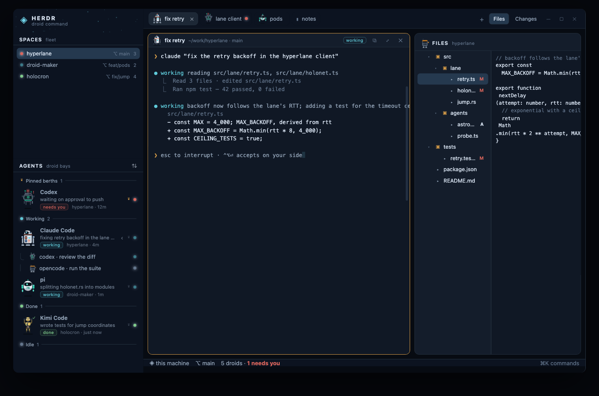

# herdr-droids — a Star Wars droid deck for the Herdr app

A [Herdr](https://herdr.dev) layout + mods that dress the whole window in a
Star Wars droid-bay theme: **every coding agent gets its own animated droid**,
and each of its four states (working, blocked, done, idle) has its own
animation. Terminal, file explorer, diff view, spaces, tabs and the status bar
all follow. Dark and light.



## Install

```sh
node tools/sync.mjs                       # copy layout, themes and mods into ~/.config/herdr-app
herdr-app do layout.switch --name droids   # or press ⌃⇧L in the app to cycle layouts
```

The app hot-reloads everything it is given, so a sync is live immediately — no
restart. Nothing of Herdr's own is touched: the layout is `layouts/droids.json`,
the themes are `themes/droids-{dark,light}.json`, and every mod folder starts
with `droids`. Go back with ⌃⇧L, or delete these names from the app home.

Escape hatch, if a layout ever traps you: `ctrl-alt-shift-escape`.

## See it in a browser first

```sh
open preview/index.html      # or: python3 -m http.server -d preview 8000
```

No build step and no network: `preview/data.js` is **generated from the real
layout, the real theme files and the real droid geometry**, so the preview is
not a redrawn approximation. `node preview/build.mjs` regenerates it after any
change to `layouts/droids.json`, `themes/*.json` or `mods/droids/droids.js`.

Controls across the top: dark / light, window / droid gallery, and buttons that
force every agent into one state so you can watch the four animations.
`#light`, `#dark`, `#gallery`, `#still` work as URL hashes for screenshots.

## The droids

| Droid | Drives | Look |
|---|---|---|
| Astromech (R-unit) | Claude Code | cream dome, terracotta + steel panels, three legs |
| Probe droid (Viper) | Codex | hovering dark orb, green iris, three claws |
| Hover pod (D-series) | pi | round hull, wide visor, π on the chest, twin thrusters |
| Protocol droid (3PO-class) | Kimi Code | gold plates, a crescent moon on the chest |
| Utility droid (GNK-class) | OpenCode | amber band, grille, treads, tool arm |
| Service droid (IT-O) | anything else | small, grey, one eye |

`mods/droids/droids.js` maps `program.key` / the agent's reported `app` to a
kind; unknown agents get the service droid, so nothing shows up bare. Add an
agent by adding a `match` entry; add a droid by adding a builder.

### States and their animations

| State | What the droid does |
|---|---|
| `working` | bobs, holo-eye sweeps, status lamp blinks, tool arms move (welding spark, rolling treads, thruster flicker) |
| `blocked` | red beacon over the head with a pulsing halo, an arm up (protocol droid waves), lamp flashes, an `!` by the head, body leans |
| `done` | hops, green lamp steady, `✓` by the head |
| `idle` | dims to ~⅔, slow "breathing", lamps out, `z` drifting up |

Everything animates natively (`.loop`, `.frames`, `.spin`) — no `cx.timer`
spinner, so an idle deck costs nothing to keep on screen.

## What's in here

```
layouts/droids.json      the window: sidebar (brand, spaces, bays, footer), tabs,
                         panes with a droid header, side panel, status bar
layouts/droids.svg       the thumbnail Settings shows for this layout
themes/droids-dark.json  deep-space deck: navy hull, holo cyan, gold accent
themes/droids-light.json Tatooine light: sand chrome, teal holo, burnt gold
mods/droids/             one mod in roles: brand, agents (the bays), footer, pane, status
mods/droids/droids.js    the droid art as plain data — shared with the preview
mods/droids/kit.js       spec tree -> div()/.loop(), plus the shared parts
mods/droids-spaces/      clone of Herdr's spaces, restyled ("SPACES / fleet", lamps)
mods/droids-tabs/        clone of the tab bar: agent tabs fly their droid
mods/droids-files/       clone of Files: "FILES / archive" with its archivist droid
mods/droids-changes/     clone of Changes: "CHANGES / hangar log" with its inspector
preview/                 the browser preview (generated, not hand-drawn)
tools/sync.mjs           install into the app home (--pull takes clones back out)
```

The four clones are Herdr's own mods, copied: the app replaces its own files on
every start, so edits go in clones, which the app never touches. Cloned mods
carry their own `kit.js` + `droids.js` + `icons/` because a mod can't import
another mod's code at run time.

## Check and iterate

```sh
node tools/sync.mjs
for m in droids droids-spaces droids-tabs droids-files droids-changes; do herdr-app check ~/.config/herdr-app/mods/$m; done
herdr-app status        # file and mod errors land here
herdr-app shot /tmp/x.png
```

`tools/sync.mjs --pull` copies the cloned mods out of the app home back into
this folder, so you can edit them in place in the app and keep this folder as
the source of truth.

## Sharing

This folder is laid out the way herdr.dev wants a layout package. For that, the
one thing missing is a `RECIPE.md` written from the shipped files — that's
started here too. Then: public repo, topic `herdr-layout`.

## Watch out

- The layout is `"theme": { "light": "droids-light", "dark": "droids-dark" }`, so
  it follows the system or Settings ▸ Appearance. The theme picker in Settings
  overrides it while a layout shows.
- Droid parts move with `.loop`, which only knows `opacity`, `left`, `top`,
  `width`, `height` — no rotation. Droids are built from plates and pillars for
  exactly that reason; anything that needs turning (a radar dish) is an `svg`
  with `.spin`.
- `mods/droids/agents.js` reads `panes()` once per render; each read copies the
  whole pane list into JS, so keep it that way.
- The bays are 62px tall — that is the price of a legible droid. Narrow the
  sidebar under 170px and they collapse to a rail of small droids and lamps.

## License

MIT — see [LICENSE](LICENSE). Herdr itself, its shipped layouts, mods and icons
are not part of this repo: the four `droids-*` mods are copies of Herdr's,
restyled, and the layout depends on Herdr being installed.

Star Wars is a trademark of Lucasfilm Ltd.; this is an affectionate fan project
with no affiliation.
