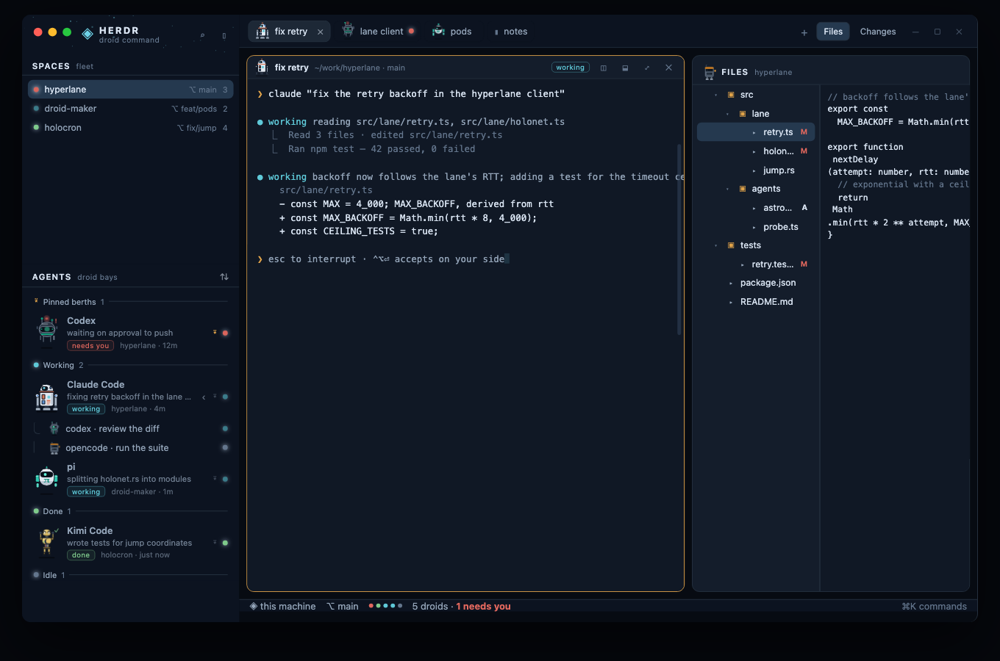

# Droids — a Star Wars droid deck

A whole Herdr window themed as a droid bay. Every coding agent is drawn as its
own droid, and the droid acts out what its agent is doing: scanning and charging
while it works, beacon flashing when it needs you, hopping when it's done,
asleep with a drifting `z` when it's idle. Terminals, the file tree, the diff
view, spaces, tabs and the status bar all wear the same deck. Dark and light.

## What you see

Left to right: a 300px sidebar, then the work column, no system title bar
(`"titlebar": "none"`, macOS traffic lights at `[16, 18]`).

**Sidebar** (`chrome`, `#0c1320` dark / `#efe8db` light):

- **Brand bar, 54px**, `window_drag`. A holo-cyan `◈` that breathes, `HERDR` in
  13px bold wide-set capitals, `droid command` in 10.5px `dim`, a faint starfield of ~20 dots
  that twinkle on long random periods, then a search button and a fold button.
  On macOS the row starts at x=82 to clear the traffic lights.
- **SPACES / fleet** — Herdr's spaces list, restyled: header 40px over a 1px
  rule (label 11.5 semibold wide-set `foreground`, caption 10.5 `dim`), rows 26px:
  a 7px holo-glow lamp in the status colour of the most urgent agent inside, the
  name, the branch, the tab count. Machine groups, worktrees, drag-reorder and
  the space menu stay exactly as Herdr ships them.
- **AGENTS / droid bays** — the centrepiece. Header 40px with a `⇅` sort toggle on
  the right ("Priority" / "By space" in its tooltip). Rows are 62px: the agent's
  droid in the open at 40×50, then the agent's name (13 semibold), what it is working on
  (11.2 `muted`, truncated), then a status chip (10px, status colour on a 10%
  wash with a 33% border) and `space · how long`. Rows breathe on hover
  (`hover`), stay `raised` while focused, and clicking one focuses its pane.
  Under the rows, group headers: `Needs you / Done / Working / Idle`, or one
  group per space.
- **Footer, 58px** — `◈ N droids docked` over the machine's real layout and rail
  keys, then icon buttons for Settings (with an update dot) and Add machine.

**Work column**:

- **Tab bar, 46px**, `window_drag`: pills 30px, radius 8, 1px `border` when
  active (`raised` background) and 1px `chrome` when not. A pill holding an
  agent flies that agent's droid at 20×26 instead of the program icon, and ends
  with a 6px status lamp. An unnamed tab takes its agent's task as its name.
  Then `+`, the text-only Files and Changes panel buttons, and the
  window buttons where the system draws none.
- **Panes**, 10px padding, 10px gaps, each framed: `background`, radius 10, 1px
  `border`, 1px `accent` (gold) while focused, and a 32px `surface` header: the droid (20×26,
  0.36 scale) or `▮` for a plain shell, the program or title in 12 semibold, the
  folder and branch in `dim`, a status chip, and split-right / split-down / zoom /
  close, always showing.
- **Side panel, 384px**, hidden until a tab-bar button opens it: `FILES / archive`
  with a utility-droid mascot, or `CHANGES / hangar log` with a probe-droid
  mascot that is agitated on conflicts, working while files are dirty and asleep
  when the tree is clean.
- **Status bar, 32px**: `◈ this machine`, the branch, then a lamp per droid (most
  urgent first, up to 10) — blocked lamps flash — then `N droids`, `M needs you`
  in the blocked colour, and the palette key on the right.

## How it behaves

Agent states, per droid (all native motion, no timers):

- **working** — the body bobs (top 0→−1.2, 1100ms; hoverers 0→−3, 1500ms) over
  a shadow that stays on the floor; its holo-eye sweeps left/right (1500ms); the
  body lamp blinks (opacity 0.35→1, 520ms); each droid does its job — the
  astromech raises its periscope (1400ms) and its chest bars race, the power
  droid waddles (left −1.5→1.5, 560ms) while its four cells charge, the probe's
  beam and iris scan together (1700ms) as its claws reach, the pod's engine
  flames flicker in height every 220/260ms, the protocol droid reads a holo
  scroll that pays out over 2200ms, and the pit droid hammers (520ms).
- **blocked** — a red beacon (5px, 360ms flash) sits over the head inside a 14px
  halo pulsing 0.08→0.34; a 14px `!` flashes beside the head; the body shudders
  (left −1→1, 460ms); the protocol droid waves an arm (left −2→3, 340ms);
  the eye sweeps back and forth in 380ms, linearly.
- **done** — the droid hops (top 0→−4, 760ms), the lamp is a steady green, a 13px
  `✓` breathes next to the head.
- **idle** — the droid dims to 0.9→0.76 over 3200ms, lamps go to hollow rings,
  eyes fade to 0.5, the protocol droid's head droops, hoverers settle 3px, and a
  `z` (`·`, `z`, `Z`, `z` at 700ms) drifts up over 2600ms at the head's right.

Hovering a bay row tints it; the sidebar under 170px becomes a rail of 30px rows
with a 0.3-scale droid and a lamp. `Priority` / `By space` in the bays' header
switches the order and drives `agent.next` / `agent.prev`. Clicking a tab pill
selects, double-clicking renames, dragging reorders — all as shipped.

## Built from

`layouts/droids.json` (root `row` → `sidebar` column 300px + `work` column) with
`"theme": {"light":"droids-light","dark":"droids-dark"}`, `background: "canvas"`,
`ui_font: ".SystemUIFont"`, `font: "JetBrains Mono"`, `font_size: 14`,
`terminal_padding: [14, 12]`, and a `pane` frame on the `tab: "active"` block
whose header is `{ "mod": "droids", "props": { "role": "pane" } }`, height 32.

Mods:

- `mods/droids/` — `main.js` default-exports a `View` that dispatches on
  `props().role` to `renderBrand`, `renderAgents`, `renderFooter`,
  `renderStatus`, `renderPane` (in `agents.js`, `chrome.js`, `pane.js`).
  `mod.json` is `{ "place": "none", "title": "Droids" }`.
- `mods/droids/droids.js` — the droid art as **plain data, no imports**:
  `KINDS`, `matchKind(name)`, `build(kind, state, palette) -> {w:56,h:72,children}`,
  `scale(tree, k)`, `palette(themeColors, dark)`. Nodes are
  `{n:'b'|'t'|'g', x, y, w, h, bg, r|rt|rb, bd:[px,color], op, anim, children}`,
  where `anim` is exactly a `LoopPolicy`: `{p:'opacity'|'left'|'top'|'width'|'height',
  from, to, period, easing}` and text nodes may carry `frames:[str], ms`.
- `mods/droids/kit.js` — `node(spec)` walks that tree into `div().absolute()
  .left().top().w().h().rounded().bg().border().opacity()` and `.loop()` /
  `.frames()`; `droid(t, kind, state, {w,h,scale,oy})` centres a scaled droid in
  a box (the art sits in its own frame so a hop moves the droid, not the box);
  `lamp`, `chip`, `head`, `stars`, `c(theme,name,darkFallback,lightFallback)`.
- Clones made with `herdr-app do mod.clone`: `droids-spaces` (spaces),
  `droids-tabs` (tabs), `droids-files` (files), `droids-changes` (changes).
  Each carries its own copy of `kit.js`, `droids.js` and `icons/` — a mod may
  not import another mod's code.
- Shipped mods still used: `menu`, `new-menu`, `picker`, `prompt`, `confirm`,
  `toast`, `peek`, `machine-add`, `worktree`, and `mods/workspace-chrome/*.svg`
  for panel glyphs.

`herdr` functions used: `agents, terminals, panes, spaces, focused, theme,
settings, layout, layouts, keys, window, run, shared, setShared, setAgentOrder,
openOverlay, exec, readTextFile, watchFolder, machines, updates`. Commands:
`pane.focus, pane.split, pane.zoom, pane.close, space.new, space.select,
space.move, tab.*, layout.select, layout.resize, app.settings, app.palette,
mod.open, terminal.pin`. No programs are run beyond Herdr's own `git` calls in
the cloned panels.

Theme files are ordinary Herdr themes plus custom names — `holo`, `holo_dim`,
`hull`, `hull_shade`, `hull_dark`, `metal`, `deck`, `signal`, `alert` — read
through `c()`, which falls back per appearance if a theme omits one.

**Preview**: `preview/build.mjs` imports `droids.js`, builds every kind × state
× appearance into `preview/data.js`, and embeds the layout JSON and both themes.
`preview/app.js` renders the layout tree with its real sizes and turns the same
node trees into divs with generated `@keyframes` (duration = `period/2`,
`alternate`, mirroring `.loop`). Nothing in it is drawn by hand.

## Watch out

- `.loop()` animates only `opacity|width|height|left|top`, once per element,
  and swings there-and-back over `period`. No rotation, no keyframe lists, no
  delay — so droids are built from plates and pillars and the pose differences
  per state are drawn, not rotated.
- The art root must be rendered by the recursive `node()`; calling `box()` on it
  drops every child and the droid vanishes (its box stays). That is silent.
- Droids are absolutely positioned: the host box needs `.relative()`, and the
  art's own hop needs a frame between the two or the box moves instead.
- `theme()` may not carry custom color names on an older app — always read them
  through `c()` with a fallback, or a light theme paints droids invisible.
- `settings().dark` decides the appearance for droid palettes; `theme()` does not
  expose it.
- `panes()` copies every pane into JS on each call — call it once per render.
- Bay rows are 62px: the smallest size at which a droid still reads.
- The cloned panels are frozen copies of whoever shipped them; after a Herdr
  update, re-clone and re-apply the edits (three small hunks per panel).
- Bays do not pin agents or expand sub-agent trees yet; they only show a `+N`
  count next to the name.

## Done when

1. `herdr-app check` passes for all five mod folders.
2. `herdr-app status` reports `"errors": []` with the layout switched.
3. A screenshot shows: a droid standing in each bay row, a droid in each
   agent's tab pill, a `working` chip in the focused pane's header, and gold
   focus borders on the panes.
4. Flip `settings.json` to `"appearance": "light"`: chrome goes sand, terminals
   go near-white, and every droid is still visible against both.
5. Open `preview/index.html` and press each of `all working / all blocked /
   all done / all idle`: the bays show four clearly different animations per
   droid, matching the app at the same sizes and colors.
